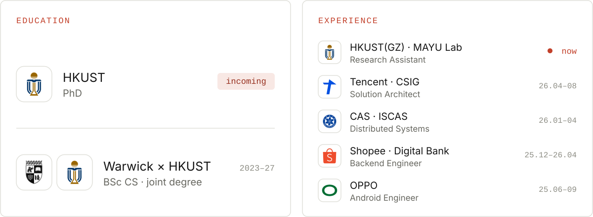
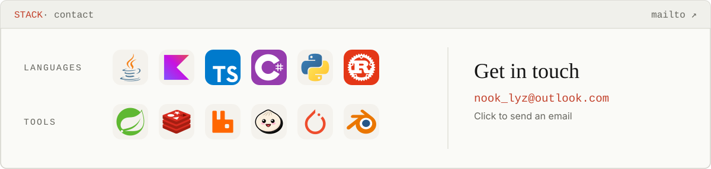

<a href="./README.md">English</a> · <a href="./README_CN.md">简体中文</a>

<a href="https://nook001.github.io/"><picture><source media="(max-width: 600px) and (prefers-color-scheme: dark)" srcset="./assets/frame/dark/hero-mobile.svg"><source media="(max-width: 600px)" srcset="./assets/frame/hero-mobile.svg"><source media="(prefers-color-scheme: dark)" srcset="./assets/frame/dark/hero.svg"></picture></a>

<picture><source media="(max-width: 600px) and (prefers-color-scheme: dark)" srcset="./assets/frame/dark/background-mobile.svg"><source media="(max-width: 600px)" srcset="./assets/frame/background-mobile.svg"><source media="(prefers-color-scheme: dark)" srcset="./assets/frame/dark/background.svg"></picture>

<a href="https://www.nexusmods.com/stardewvalley/mods/40775"><picture><source media="(max-width: 600px) and (prefers-color-scheme: dark)" srcset="./assets/frame/dark/project-dynamic-shader-mobile.svg"><source media="(max-width: 600px)" srcset="./assets/frame/project-dynamic-shader-mobile.svg"><source media="(prefers-color-scheme: dark)" srcset="./assets/frame/dark/project-dynamic-shader.svg"></picture></a>

<a href="https://github.com/Nook001/MyWarwickPlus"><picture><source media="(max-width: 600px) and (prefers-color-scheme: dark)" srcset="./assets/frame/dark/project-mywarwickplus-mobile.svg"><source media="(max-width: 600px)" srcset="./assets/frame/project-mywarwickplus-mobile.svg"><source media="(prefers-color-scheme: dark)" srcset="./assets/frame/dark/project-mywarwickplus.svg"></picture></a>

<a href="https://github.com/Nook001/QingyinPlayer"><picture><source media="(max-width: 600px) and (prefers-color-scheme: dark)" srcset="./assets/frame/dark/project-qingyin-mobile.svg"><source media="(max-width: 600px)" srcset="./assets/frame/project-qingyin-mobile.svg"><source media="(prefers-color-scheme: dark)" srcset="./assets/frame/dark/project-qingyin.svg"></picture></a>

<a href="mailto:nook_lyz@outlook.com"><picture><source media="(max-width: 600px) and (prefers-color-scheme: dark)" srcset="./assets/frame/dark/footer-mobile.svg"><source media="(max-width: 600px)" srcset="./assets/frame/footer-mobile.svg"><source media="(prefers-color-scheme: dark)" srcset="./assets/frame/dark/footer.svg"></picture></a>

Text version

**Nook** — Render | Agent | System · [nook001.github.io](https://nook001.github.io/)

**Education**
- HKUST — PhD (incoming)
- University of Warwick × HKUST — BSc Computer Science, joint degree, 2023–2027

**Experience**
- HKUST(GZ), MAYU Lab — Research Assistant · Sep 2026 – present
- Tencent, CSIG — Solution Architect · Apr – Aug 2026
- CAS, Institute of Software — Distributed Systems · Jan – Apr 2026
- Shopee, Digital Bank — Backend Engineer · Dec 2025 – Apr 2026
- OPPO, Internet Services & Ecosystem — Android Engineer · Jun – Sep 2025

**Projects**
- [Dynamic Shader](https://www.nexusmods.com/stardewvalley/mods/40775) — dynamic lighting, shadows and water effects for Stardew Valley; 250K+ downloads. HLSL · C# · Harmony
- [MyWarwickPlus](https://github.com/Nook001/MyWarwickPlus) — a native Android client for Warwick timetables, coursework and messages. Kotlin · Jetpack Compose
- [Qingyin](https://github.com/Nook001/QingyinPlayer) — a Chinese-first local music player for Linux. Rust · Qt Quick · GStreamer

**Stack** — Java, Kotlin, TypeScript, C#, Python, Rust · Spring, Redis, RabbitMQ, Bun, PyTorch, Blender

**Contact** — [nook_lyz@outlook.com](mailto:nook_lyz@outlook.com)

