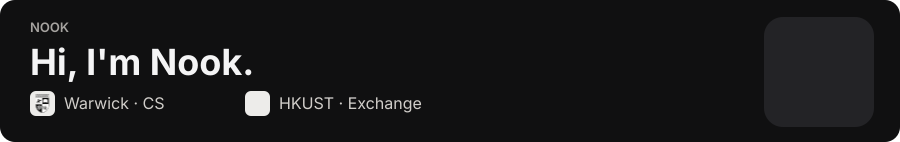
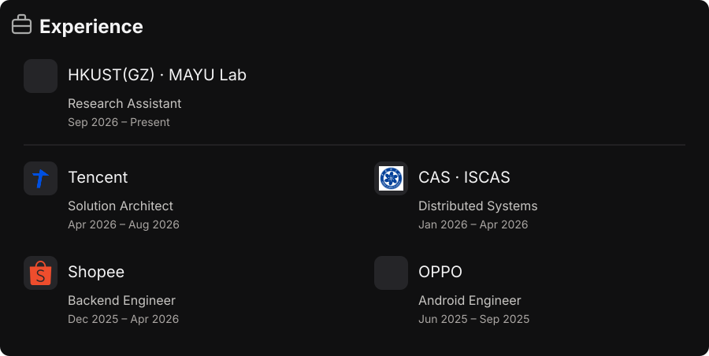
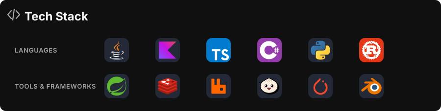

<a href="./README.md">English</a> · <a href="./README_CN.md">简体中文</a>

<a href="https://github.com/Nook001/MyWarwickPlus"><strong>MyWarwickPlus</strong></a> · A better mobile experience for Warwick students. &nbsp;&nbsp;&nbsp; <a href="https://github.com/Nook001/QingyinPlayer"><strong>Qingyin</strong></a> · A lightweight Linux music player.

