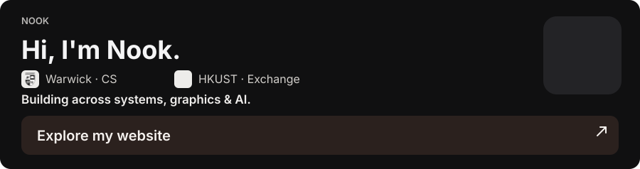
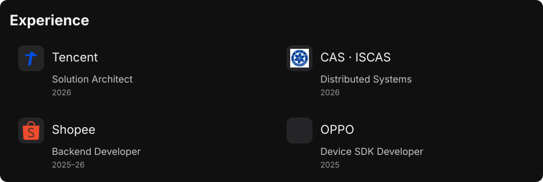
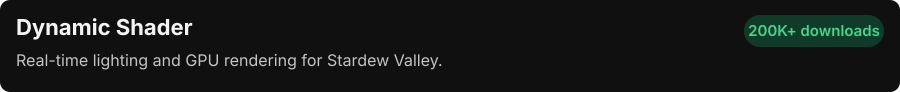

<a href="./README.md">English</a> · <a href="./README_CN.md">简体中文</a>

### Selected Projects

<table>
<tr>
<td width="50%" valign="top">

 <a href="https://github.com/Nook001/MyWarwickPlus"><strong>MyWarwickPlus</strong></a> 
A better mobile experience for Warwick students.
</td>
<td width="50%" valign="top">

 <a href="https://github.com/Nook001/QingyinPlayer"><strong>Qingyin</strong></a> 
A lightweight Linux music player.
</td>
</tr>
</table>
