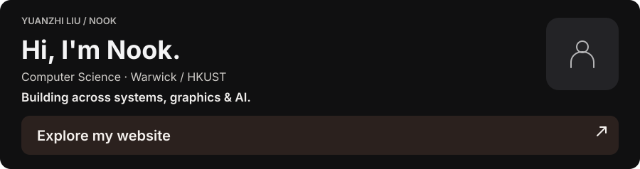

<a href="./README.md">English</a> · <a href="./README_CN.md">简体中文</a>

## Experience

| Organization | Role | Period |
| --- | --- | --- |
| **Tencent · CSIG** | Solution Architect | Apr – Aug 2026 |
| **Chinese Academy of Sciences · ISCAS** | Distributed Systems Developer | Jan – Apr 2026 |
| **Shopee · Digital Bank** | Backend Developer | Dec 2025 – Apr 2026 |
| **OPPO** | Device SDK Developer | Jun – Sep 2025 |

## Selected Projects

- **[Dynamic Shader ↗](https://www.nexusmods.com/stardewvalley/mods/40775)** — Real-time lighting and shadows for Stardew Valley. **200K+ downloads**.
- **[MyWarwickPlus ↗](https://github.com/Nook001/MyWarwickPlus)** — A lightweight native Android client for Warwick students.
- **[Qingyin ↗](https://github.com/Nook001/QingyinPlayer)** — A local Linux music player built with Rust and Qt.

More about me, my work and my writing: **[nook001.github.io ↗](https://nook001.github.io/)**
