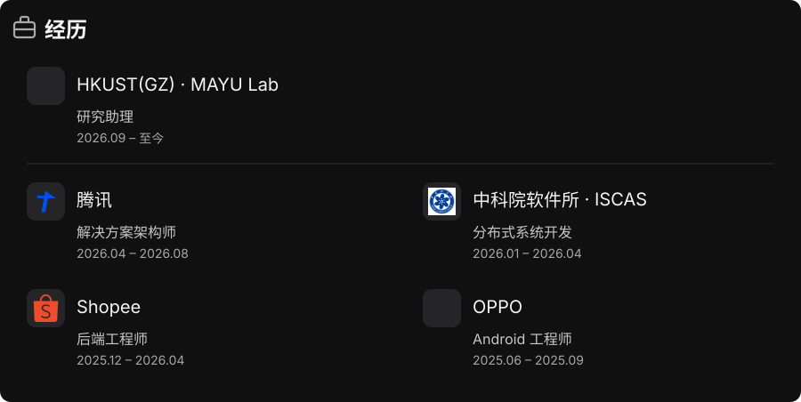

<a href="./README.md">English</a> · <a href="./README_CN.md">简体中文</a>

<a href="https://github.com/Nook001/MyWarwickPlus"><strong>MyWarwickPlus</strong></a> · 为华威大学学生打造的移动客户端。 &nbsp;&nbsp;&nbsp; <a href="https://github.com/Nook001/QingyinPlayer"><strong>Qingyin 清音</strong></a> · 轻量级 Linux 本地音乐播放器。

