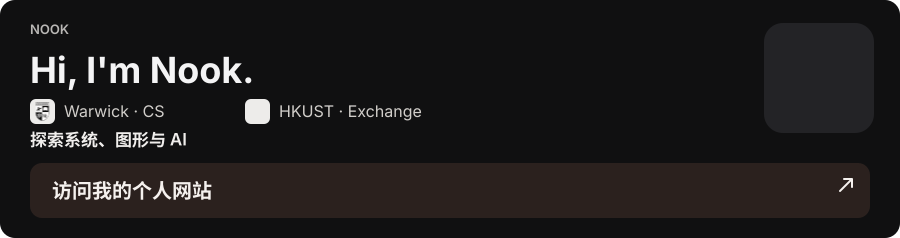
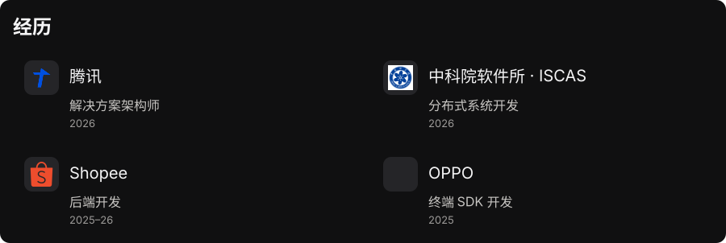

<a href="./README.md">English</a> · <a href="./README_CN.md">简体中文</a>

### 精选项目

<table>
<tr>
<td width="50%" valign="top">

 <a href="https://github.com/Nook001/MyWarwickPlus"><strong>MyWarwickPlus</strong></a> 
为华威大学学生打造的移动客户端。
</td>
<td width="50%" valign="top">

 <a href="https://github.com/Nook001/QingyinPlayer"><strong>Qingyin 清音</strong></a> 
轻量级 Linux 本地音乐播放器。
</td>
</tr>
</table>
