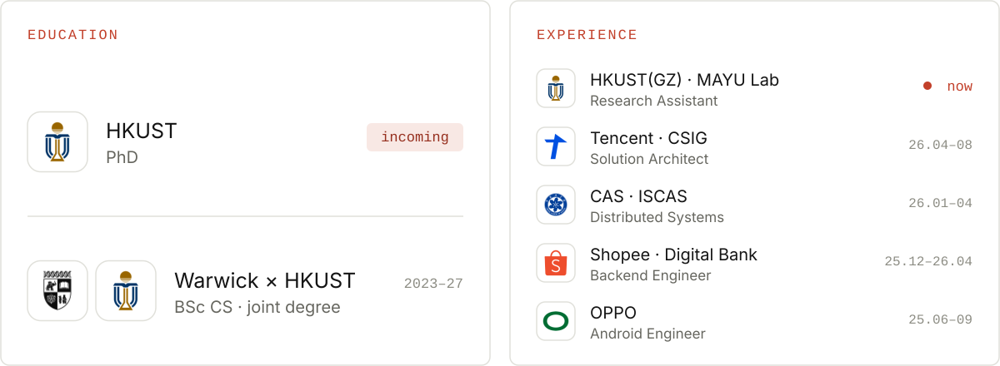

<a href="./README.md">English</a> · <a href="./README_CN.md">简体中文</a>

<a href="https://nook001.github.io/"><picture><source media="(max-width: 600px) and (prefers-color-scheme: dark)" srcset="./assets/frame/dark/hero-mobile.svg"><source media="(max-width: 600px)" srcset="./assets/frame/hero-mobile.svg"><source media="(prefers-color-scheme: dark)" srcset="./assets/frame/dark/hero.svg"></picture></a>

<picture><source media="(max-width: 600px) and (prefers-color-scheme: dark)" srcset="./assets/frame/dark/background-mobile.svg"><source media="(max-width: 600px)" srcset="./assets/frame/background-mobile.svg"><source media="(prefers-color-scheme: dark)" srcset="./assets/frame/dark/background.svg"></picture>

<a href="https://www.nexusmods.com/stardewvalley/mods/40775"><picture><source media="(max-width: 600px) and (prefers-color-scheme: dark)" srcset="./assets/frame/dark/project-dynamic-shader-mobile.svg"><source media="(max-width: 600px)" srcset="./assets/frame/project-dynamic-shader-mobile.svg"><source media="(prefers-color-scheme: dark)" srcset="./assets/frame/dark/project-dynamic-shader.svg"></picture></a>

<a href="https://github.com/Nook001/MyWarwickPlus"><picture><source media="(max-width: 600px) and (prefers-color-scheme: dark)" srcset="./assets/frame/dark/project-mywarwickplus-mobile.svg"><source media="(max-width: 600px)" srcset="./assets/frame/project-mywarwickplus-mobile.svg"><source media="(prefers-color-scheme: dark)" srcset="./assets/frame/dark/project-mywarwickplus.svg"></picture></a>

<a href="https://github.com/Nook001/QingyinPlayer"><picture><source media="(max-width: 600px) and (prefers-color-scheme: dark)" srcset="./assets/frame/dark/project-qingyin-mobile.svg"><source media="(max-width: 600px)" srcset="./assets/frame/project-qingyin-mobile.svg"><source media="(prefers-color-scheme: dark)" srcset="./assets/frame/dark/project-qingyin.svg"></picture></a>

<a href="mailto:nook_lyz@outlook.com"><picture><source media="(max-width: 600px) and (prefers-color-scheme: dark)" srcset="./assets/frame/dark/footer-mobile.svg"><source media="(max-width: 600px)" srcset="./assets/frame/footer-mobile.svg"><source media="(prefers-color-scheme: dark)" srcset="./assets/frame/dark/footer.svg"></picture></a>

文字版

**Nook** — Render | Agent | System · [nook001.github.io](https://nook001.github.io/)

**教育**
- 香港科技大学 — PhD（即将入学）
- 华威大学 × 香港科技大学 — 计算机科学本科，联合学位，2023–2027

**经历**
- HKUST(GZ) MAYU Lab — 研究助理 · 2026.09 – 至今
- 腾讯 CSIG — 解决方案架构师 · 2026.04 – 2026.08
- 中国科学院软件研究所 — 分布式系统 · 2026.01 – 2026.04
- Shopee Digital Bank — 后端工程师 · 2025.12 – 2026.04
- OPPO Internet Services & Ecosystem — Android 工程师 · 2025.06 – 2025.09

**项目**
- [Dynamic Shader](https://www.nexusmods.com/stardewvalley/mods/40775) — 为星露谷物语带来动态光照、阴影与水面效果，Nexus Mods 下载量 250K+。HLSL · C# · Harmony
- [MyWarwickPlus](https://github.com/Nook001/MyWarwickPlus) — 华威大学课表、作业与消息的原生 Android 客户端。Kotlin · Jetpack Compose
- [清音 Qingyin](https://github.com/Nook001/QingyinPlayer) — 中文优先的 Linux 本地音乐播放器。Rust · Qt Quick · GStreamer

**技术栈** — Java、Kotlin、TypeScript、C#、Python、Rust · Spring、Redis、RabbitMQ、Bun、PyTorch、Blender

**联系** — [nook_lyz@outlook.com](mailto:nook_lyz@outlook.com)

